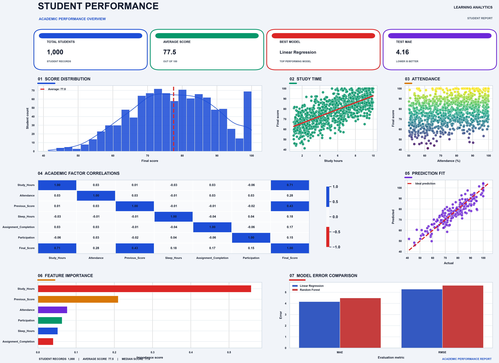

# Student Performance Insights & Prediction

A Python-based data science project that explores academic performance patterns and predicts students' final scores using supervised machine learning.

The project creates a reproducible synthetic student dataset, performs exploratory data analysis, compares regression models, evaluates prediction quality, and presents the findings through a high-contrast academic visual report.

> **Dataset note:** The notebook generates 1,000 synthetic student records for demonstration and learning. It is not real student data and should not be used to make real academic decisions.

## Project Overview

This project examines how study habits and academic indicators relate to student outcomes. It uses Python's data analysis and visualization ecosystem to turn a structured dataset into interpretable findings and a baseline prediction workflow.

## Key Features

- Synthetic student dataset generation with a fixed random seed
- Data inspection, descriptive statistics, missing-value checks, and duplicate checks
- Exploratory analysis of student scores and academic indicators
- Correlation analysis between numerical features
- Regression model training and comparison
- Model evaluation using MAE, RMSE, and R²
- Automatic selection of the model with the lower MAE
- Feature-importance analysis using Random Forest
- Reusable function to estimate a student's final score
- Export of charts, the dataset, and the trained model

## Visual Analysis

The notebook creates visualizations for:

- Final score distribution
- Study hours versus final score
- Attendance versus final score
- Academic feature correlation heatmap
- Actual versus predicted scores
- Feature importance
- Regression model error comparison
- A consolidated academic performance visual report

### Preview

Run the notebook to generate the visual report at:

`images/student_performance_dashboard.png`

You can add a screenshot or exported image to this section after running the notebook:



## Machine Learning Workflow

Two regression algorithms are trained and compared:

1. **Linear Regression**
2. **Random Forest Regressor**

Both models are evaluated on the same held-out test set. The notebook reports:

- **MAE (Mean Absolute Error):** average absolute prediction error
- **RMSE (Root Mean Squared Error):** error metric that gives more weight to larger errors
- **R² Score:** proportion of target variance explained by the model

The model with the lower MAE is selected for the example prediction workflow.

## Dataset Features

The generated dataset contains 1,000 rows and the following columns:

| Feature | Description |
|---|---|
| `Study_Hours` | Daily study hours |
| `Attendance` | Attendance percentage |
| `Previous_Score` | Previous academic score |
| `Sleep_Hours` | Daily sleep hours |
| `Assignment_Completion` | Assignment completion percentage |
| `Participation` | Class participation level |
| `Final_Score` | Generated final exam score (target) |

The target is created from a predefined synthetic relationship with added random noise. The notebook uses a fixed random seed so the dataset can be reproduced.

## Tech Stack

- Python
- NumPy
- Pandas
- Matplotlib
- Seaborn
- Scikit-learn
- Joblib
- Jupyter Notebook

## Repository Structure

```text
student-performance-insights/
│
├── student_performance_insights.ipynb
├── README.md
├── requirements.txt
├── .gitignore
│
├── data/
│   └── student_performance_dataset.csv
│
├── images/
│   ├── score_distribution.png
│   ├── study_hours_vs_score.png
│   ├── attendance_vs_score.png
│   ├── correlation_heatmap.png
│   ├── actual_vs_predicted.png
│   ├── feature_importance.png
│   ├── model_comparison.png
│   └── student_performance_dashboard.png
│
└── models/
    └── student_performance_model.pkl
```

The `data/`, `images/`, and `models/` folders are created/populated when the notebook is run. The listed image and output files may not exist in a fresh clone until execution.

## Getting Started

### 1. Clone the repository

```bash
git clone https://github.com/your-username/student-performance-insights.git
cd student-performance-insights
```

### 2. Create and activate a virtual environment (recommended)

**Windows**

```bash
python -m venv .venv
.venv\\Scripts\\activate
```

**macOS / Linux**

```bash
python3 -m venv .venv
source .venv/bin/activate
```

### 3. Install dependencies

```bash
pip install -r requirements.txt
```

### 4. Launch Jupyter Notebook

```bash
jupyter notebook
```

Open `student_performance_insights.ipynb` and run the cells from top to bottom.

The notebook generates the synthetic dataset, charts, visual report, and trained model in their respective folders.

## Example Prediction

The notebook includes a reusable `predict_student_score()` function. Provide values for study hours, attendance, previous score, sleep hours, assignment completion, and participation to obtain an estimated final score and an illustrative performance category.

## Skills Demonstrated

- Data generation and preprocessing
- Exploratory data analysis (EDA)
- Feature relationships and correlation analysis
- Data visualization and visual storytelling
- Regression modelling
- Model evaluation and comparison
- Feature importance
- Reusable prediction functions
- Saving and loading machine learning models
- Organizing a reproducible Python project

## Limitations

- The dataset is synthetic and generated from an illustrative formula.
- Model results reflect that synthetic data-generating process, not real-world student populations.
- Feature importance and predictions should be interpreted as educational demonstrations.
- Real deployment would require representative, ethically collected data, validation, and careful review for bias.

## Future Improvements

- Evaluate models with cross-validation
- Add additional regression algorithms
- Tune model hyperparameters
- Add interactive prediction inputs
- Test on a suitable real-world, ethically sourced dataset
- Add automated tests and a reproducible experiment report

## License

Choose a license before publishing this repository. For example, an MIT License can be added if you want others to reuse and adapt the project.
